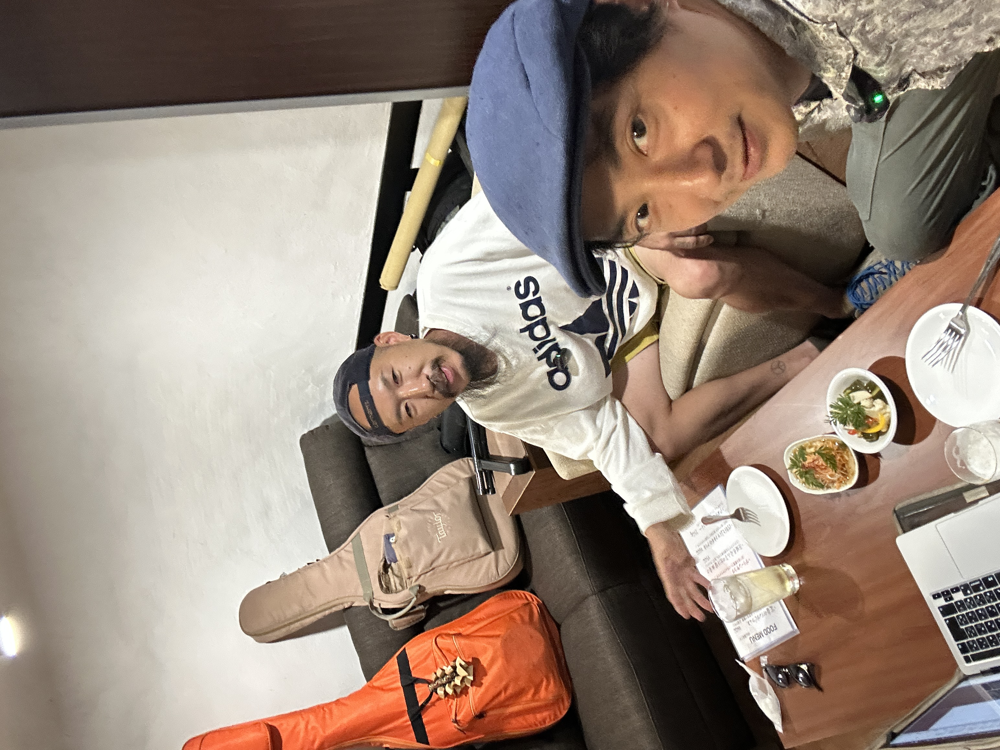

**さとレックス（以下さとレ）：** アフターパーティー、今回はゲストにワタナベファミリーさんをお迎えいたします。よろしくお願いします。

**ワタナベファミリー（以下ワタナベ）：** よろしくお願いします。

**さとレ：** まずは、わざわざ遠いところに来てくださいましてありがとうございます。

**ワタナベ：** ぜんぜん近い。ほんと近かったです。……素敵なお店。

**さとレ：** いずれ、互いに日が合ったら、ここでライブをやってもらったりして、僕が見に来たりして。

**ワタナベ：** おっ！　やりましょう、ぜひ。最高じゃないですか。想像を超えて素敵ですね。

**さとレ：** これからね、さらに絶品のハンバーグが来るんで、楽しみにしててください。

**ワタナベ：** 燻製のやつですね。楽しみだな。……こんなに輝いてるピクルスないですよ。

**さとレ：** 乾杯！　……しかし僕は、食べ物を撮るセンスがまた絶望的で。

**ワタナベ：** そうですか？　いや、上手っすよ。俺も写真は下手っぴですから。……あ、いいですね。いい感じですよ。

**さとレ：** お褒めいただいて光栄です。

**ワタナベ：** ありがとうございます。……なんか緊張してますね。

**さとレ：** 緊張すんの？

**ワタナベ：** いえいえいえいえ。さとレックスさんとがっつり対面でしゃべることもなかなか……だいたい俺、酔っぱらっちゃってるんで。緊張からの緩和になっちゃうんで。

<!--more-->

**さとレ：** マガジンをやりたいなーと思ったきっかけの一つが、なんかね、しゃべりたいんだけど、ライブの日ってあんまりしゃべる暇がないので。

**ワタナベ：** おー、おしゃれだな。……行っていいすか、俺。

**さとレ：** どうぞどうぞ、行っちゃってください。

**ワタナベ：** じゃあベタに、キュウリをいただきます。……うま！　ちょうどいい！

**さとレ：** 甘さとね、さっぱり感が。

**ワタナベ：** これは進みますね。うま！　ここまでちょうどいいピクルス、なかなかないですね。……がっぷり行っていいですか？

**さとレ：** どうぞ。

**ワタナベ：** 野菜の良さが生きてますね。うまい。

**さとレ：** （笑）さすが。……そう、で、ライブの日ってね、人の演奏の合間にちょびっと喋るしかできないし、その後ゆっくり喋ろうにも、次の仕事だしな、とかがあって。

**ワタナベ：** ありますね。俺だいたい酔い潰れちゃって、もう分からなくなっちゃってますからね。

**さとレ：** っていうのと、よく会ってる人なんだけど、あんまり人となりを実は知らないなってことも感じてて。別に、知らなきゃダメだとか全然思わないんだけど、でも……

**ワタナベ：** 確かに。いや、でも、ね、知りたいですね、知れるなら。それは分かります。

**さとレ：** 誰かのブログ読んでたのかな？　ちょっと覚えてないけど、「深く知れるってちょっといいのかな」みたいなことを思って。だから地元のミュージシャンたちを紹介したいし、互いが互いを知り合った状態で「久しぶり」ってなるのも、仲が深まるし。

**ワタナベ：** 深まりますね、確かに。

**さとレ：** だし、今ライブバーに来ないお客さんに——例えば、これのQRコードが普通の飲み屋さんのカウンターとか壁に貼り付けてあったりして。「暇だからちょっと読んでみよう」で、「へー、こんな人地元にいるんだ」みたいな。

**ワタナベ：** なるほどな。楽しいですね。確かにその人を知ると、次会ったときに入りやすいというか。久しぶりが、より久しぶりになります。

**さとレ：** （笑）そうですね。

**ワタナベ：** 俺もコミュニケーション苦手なんで、一度会って、わーって会っても、次会うとリセットしちゃったりします。それがね、悔しくてね。

短いスパンでパパパッと会ってればまた違うんすけど、3ヶ月とか、普通に空くじゃないですか、ミュージシャンって。下手すりゃ1年2年ぶりとかザラなんで。

**さとレ：** 1回打ち解けたけど、次会う時はもう「久しぶり」。

**ワタナベ：** ありますよね。わかるわ、面白いな。次会う約束を別にせずとも会いますからね。面白い世界ですね。

---

**さとレ：** 最初にちょっとお聞きしちゃおうかなと思うのが……

**ワタナベ：** はい、聞いてください。

**さとレ：** ワタナベファミリーっていうステージ名は、どっから来たんですか？

**ワタナベ：** もともと違う名前で昔やってたんですよ。20〜25ぐらいまでバンドやってて、それがダメになっちゃって。それで、まぁ弾き語りやってたんすけど。

その時、どこに歌いに行ってもいいか分かんないし……でも確実に、もう俺は音楽で食ってくって夢見てたんで。確実に進むべき道は見えてるのに、どうしていいか分かんないって時期に、落ち込んだ——じゃないけど、ほんと外も出れないぐらいになっちゃった時あるんですよ。なんか怖くて。

で、そんな時に、ほんと唯一、なんだろうな……心を許せたというか、正直になれたのが、やっぱ奥さんだったり、息子であったり、家族だったんで。「ああ、これはもう、俺はファミリーとして生きていく」って決めて。

それまでなんかね、ちょっと格好つけた名前とかつけてたんすけど、もういいやと思って、ワタナベファミリーで。シンプルで、もう家族を背負って——っていうほどあれですけど、本当、家族にね、助けてもらいながら、わがままな人生を送ってる。

**さとレ：** めちゃくちゃいい話じゃない？

**ワタナベ：** いやいやいや。これもやっぱ、こういう場でないとね。

**さとレ：** これ、文章で載せちゃっても大丈夫ですか？

**ワタナベ：** あ、全然大丈夫です！　全然もう、素材フリーでお願いします。……逆に、さとレックスさんって、レックスって、あの恐竜？

**さとレ：** これはね、一言で言うとT-REXのREXで。若かりし頃にT-REX的なグラムロックに憧れてて。やってたバンドはロックンロールなんだけど、もともと髪は天パーなんだけど、ちょっとアフロ的に伸ばしながらパーマさらにかけたりして。

**ワタナベ：** （笑）

**さとレ：** で、そこに、なけなしのお金で作ってもらったシルクハットがありまして。それをかぶってライブをやったりしてたんですよ。

**ワタナベ：** はいはい、なるほどな。いいっすね。似合いそうですね。

**さとレ：** そう、実際に似合う。

**ワタナベ：** ですよね、絶対似合う。

**さとレ：** 今でも巨乳まんだら王国っていうバンドをやってて、それは全員仮装してやるんで、そのステージ衣装にまだ使ってます。それこそマーク・ボラン的な、ドンキで買った安いウィッグにシルクハットで、燕尾服を着てっていう。貴族的な出で立ちで。

**ワタナベ：** いや、いいですね。最高のエンターテイナーですね。……すごいバンド名ですね。

**さとレ：** そうなんですよ。

**ワタナベ：** えー、すげー。

**さとレ：** で、シルクハットでライブをやってた時に、当時マキシマム ザ ホルモンとちょうど出会ったぐらいだったんですよ。多分今から28年前ぐらいじゃないかな。向こうもインディーズで1枚か2枚出したかなぐらいの、駆け出しの頃で。

その時にね、川北姉弟に「サトシです」って自己紹介したら、「サトレックス！」って呼ばれるようになって。だってT-REXでしょ？　って。

**ワタナベ：** すごい。なるほどな。

**さとレ：** で、「サトレックスっていいな」と思って、それからさとレックスって名乗るようになって。

**ワタナベ：** えー、名付け親は実は、って感じですね。すげーな。覚えやすいですもんね、サトレックス。

**さとレ：** 覚えやすいのかな？　これ、微妙に不親切なのが、「さと」がひらがなで「レックス」がカタカナなの。人に文字の切り替えをさせるところが不親切だと思ってます。

**ワタナベ：** いえいえ、もっと変換しなきゃいけない人いっぱいいますから。

**さとレ：** で、本名が鈴木聡っていうんで、一意性がすごく低い名前っていうか。鈴木もありふれてれば聡もありふれてて、なんならフルネームになってすら、脚本家にエゴサで負けるんです。なんかステージネームあるとやっぱ便利だよなっていうのがあって。

**ワタナベ：** いいですね。一度見たら忘れないですよ、さとレックス。……そうですよね、俺も渡辺和也ですから。

**さとレ：** おー。

**ワタナベ：** いっぱいいるんですよ、きっと。もういっぱいいます。

**さとレ：** まあ、お互い様だよ。

**ワタナベ：** お互い様です。えー、面白いな、人のそういうの。ちゃんとドラマがありますね。

**さとレ：** 名前ひとつでも、やっぱりそれぞれありますね。

**ワタナベ：** そうなんですよ。聞かなきゃわかんないことですからね。

**さとレ：** だから、ほんと人としゃべるのって、しゃべるだけでやっぱ面白いなーって思うんですよね。

**ワタナベ：** いやー、すごい。そういうの俺、苦手というか分かんないですよね。ここは何を聞くのがベストか。ちょうどいいところを来てくれますね、さとレックスさんは。

**さとレ：** あー、僕は聞きたいこと聞いてるだけなんでね。

**ワタナベ：** いやいやいや。俺も聞いてもらえないと喋れないことばっかりなんで。自分からあんまりこう、なんだろな……自慢話じゃないけど、その話したくないんですよ。

**さとレ：** そう、ヒーローインタビューを受けるから話せる、宝物みたいなものがありますよね。

**ワタナベ：** ありますよね。なんかね、ちょっと自分の中のあれこれ。……やっぱありがたいな。嬉しい。これもいただこう。砂肝。

---

*[第2話につづく](../02/index.md)*
