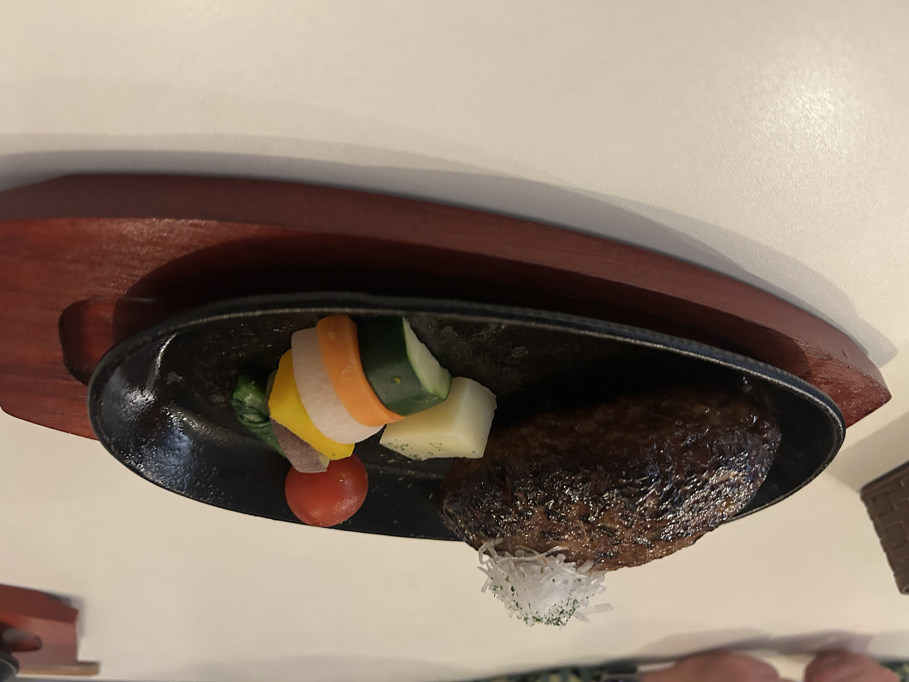

**さとレ：** さっきちょっと予告しましたけど、ワタナベファミリーさん、子供の頃ってどんな子供でした？　覚えてる限りで最も小さい頃から、「こんな子供だったよ」っていうのあります？

**ワタナベ：** 幼稚園ぐらいから、ぼやっとした記憶ですけど、基本泣き虫っすね。泣き虫というか、根性なし。幼稚園の時は本当、根性なし人間以下だったんすよ。幼稚園行きたくないってバスで泣いてみたりとか。

**さとレ：** へぇ。

**ワタナベ：** あとはね、サッカーのなんかあれの時に転んで泣いて、親に迎えに来てもらったりとか。

ですけど、小学校に入って、4年くらいになって……バカじゃないけど、やんちゃじゃないけど、憧れじゃないけど、「俺はバカになりたい」って思った変なやつで。そう。それで、やっぱ周りもね、似たようなの集まるんで。結構小学校の時は親に怒られたり、先生にね、怒られたりしてましたよ、ホント。

<!--more-->

**さとレ：** じゃあ、あれですね。バカな子供が板につき始めた。

**ワタナベ：** 板につき始めた（笑）。そうですね。三年生ぐらいまではね、結構頑張ってたんですけどね。頑張ってたっていうのもおかしいけど。なんか妙にしっくりくるぞと思って、そっからまあ、いろいろ楽しんでましたね。

**さとレ：** なんかきっかけあったんですか？

**ワタナベ：** バカに憧れる、みたいな？　んー……なんか先生にこう怒られて、それを「へっちゃらだー」っつって、なんかやーってやるのが、妙に楽しかったんですよ。

**さとレ：** おー。

**ワタナベ：** そこからやっぱ同じ、ね、同じ種類——種類って言ったらおかしいけど——の友達が集まって。そんなのがいっぱい集まるから、やることはいたずらだらけなんで。

そんなんでしたよ、小学校までは。まあ、ずっと基本それですけど……どこまでが子供っつうんすかね。中学ぐらいまでですかね？　いや、わかんないですけど。

**さとレ：** 中学ぐらいまでで。で、中学校では部活とかやられてました？

**ワタナベ：** 部活はバスケ部にちょっと入ってたんすけど。俺、小学校の時も野球はやってたんすよ。兄貴が4つ上で、親父が監督。野球バカだったんで。

**さとレ：** はええ。

**ワタナベ：** 俺イヤイヤ野球やってて。しかも、うちの親父、昔の監督やるぐらいなんで、結構もうすごいんすよ。それで俺、もう誰かに何かを教わるのがすごい嫌いになっちゃって。

**さとレ：** はええ。

**ワタナベ：** そう。で、バスケもやっぱりね、よくわかんない先生に教わるじゃないですか。つまんねえと思って、すぐ辞めちゃって。

それが中学一年の時なんですけど、その時に、やっぱり小学校から変わってないんで、先輩に狙われてたんすよ。

**さとレ：** ああ、はいはいはい。

**ワタナベ：** 「三宅原小学校で一番悪い奴は誰だ」っつわれて、みんなが「俺だ」みたいなこと言って。で、俺自身に「四組のワタナベって知ってる？」とか、怖い先輩に聞かれたりして。うわ、やだーと思って。

一年生のときは、ほんと、入って三ヶ月四ヶ月ぐらいから、もう学校行かなくなって。怖くて。毎日それがあるんで。その当時の二歳差なんて、でかいじゃないですか。

**さとレ：** まあ、でかいですよね。

**ワタナベ：** 「うわっ、こえーっ」ってなって。で、そこで家に引きこもったとき——まあ外には出てましたけど——

*（燻製ハンバーグが運ばれてくる）*

**ワタナベ：** おお、やばい、来た。

**さとレ：** 絶品のハンバーグ。

**ワタナベ：** うわ、来た来た。ウイスキーの樽で燻すやつ。やば、何ですかこれ。ありがとうございます！　嬉しい。

**さとレ：** 食べて食べて。取材とかいいから。

**ワタナベ：** え、これはどうやって……

**さとレ：** 塩を振って。胡椒を味変で。

**ワタナベ：** なるほど。……うわ、こんなに緊張するハンバーグ初めて。うわ、うまそう。うわ、やっば。

**さとレ：** その出た肉汁をちょっと染み込ませたりしながら。

**ワタナベ：** なるほど、グルメっすね。……いただきます。

**さとレ：** 行っちゃって。

**ワタナベ：** うまっ。……うまっ。ちゃんと燻製の香りが。これはうまいっすね……！　なんですか。もう一回言っていいですか？

**さとレ：** どうぞ。

**ワタナベ：** うまっ。

**さとレ：** 肉質がしっとりしてる。しかも、しっかりしてるから。

**ワタナベ：** うんうんうん、うめぇ。ちょうどいい固さ。

**さとレ：** ちょうど先週、ホリデイズのメンバーと来て、やっぱうめえなーって。

---

*――ひとしきりハンバーグを堪能したあと、話は中学一年の頃に戻る。*

**ワタナベ：** そう、それで、中一の不登校の時に、スタジオジブリに逃げた——じゃないけど。すげー穏やかな世界じゃないですか。

**さとレ：** 確かに。

**ワタナベ：** 自分が中学校行って、なんかそんな感じになっちゃったんで。ほんとただただ、幸せの中で巻き起こる、そこが良くて。

しかも昔から、おじさんが山の人だったんで、キノコ取り行ったりとか、自然が好きだったんですよ。そこで、となりのトトロですよね。あの世界観が、キラッキラして見えて。

**さとレ：** （笑）

**ワタナベ：** だからホント、あのトトロの家みたいな家に住みたいんすよ、俺は。で、茂木に引っ越したんすけど。

**さとレ：** なるほどね。そこの移住のストーリーも後で語ってもらいたいですけど。子供時代のワタナベさんとしては、別にグレてるとかじゃなくて。

**ワタナベ：** 全然全然。

**さとレ：** 単にバカやって笑ってられればそれでよかったのに、中学になったら「おめえ調子乗ってんじゃねえぞ」みたいな話になってきて。いや、そんなことをしたいんじゃないんだよ、と。

**ワタナベ：** そうなんです。で、ホント1年間、ジブリばっか見てました。

---

*[第3話につづく](../03/index.md)*
